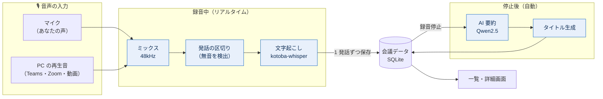
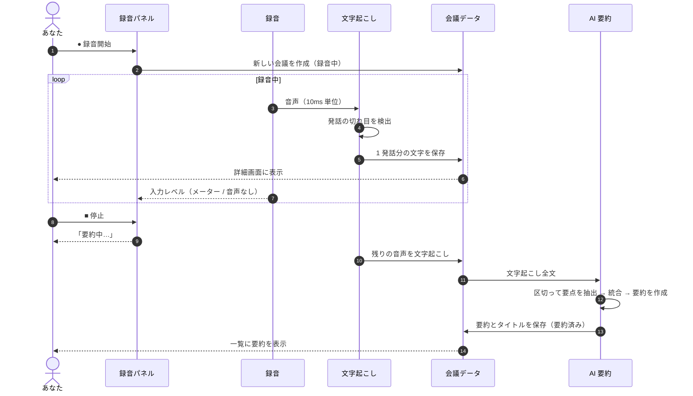
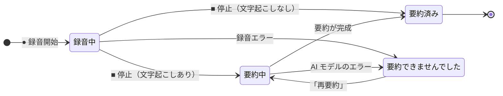
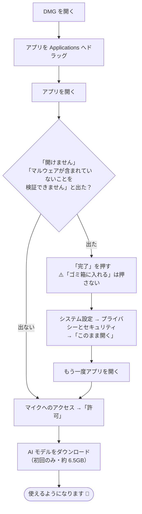
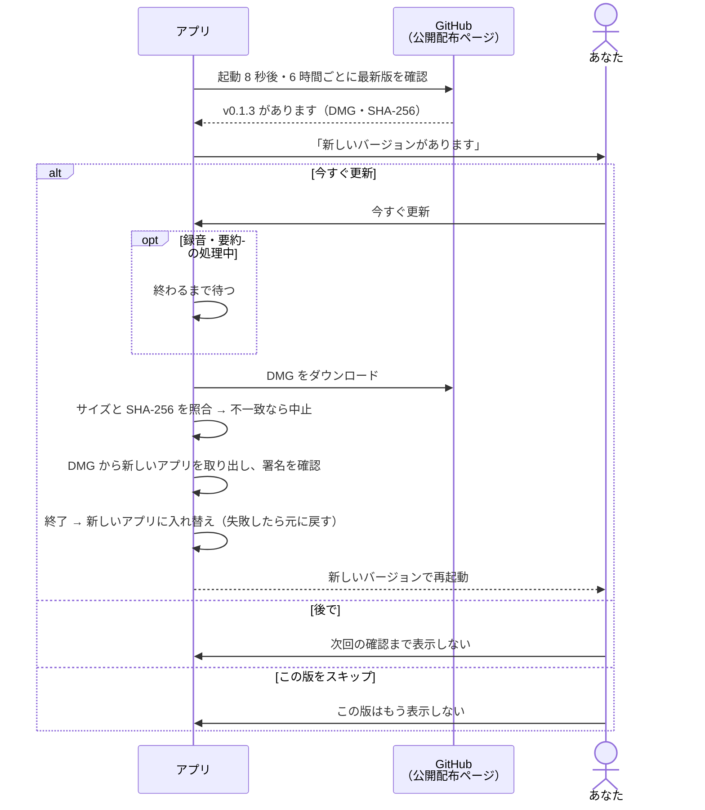
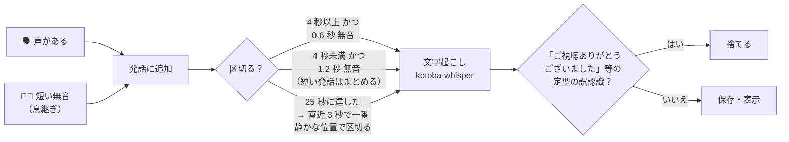
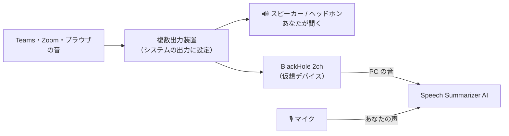
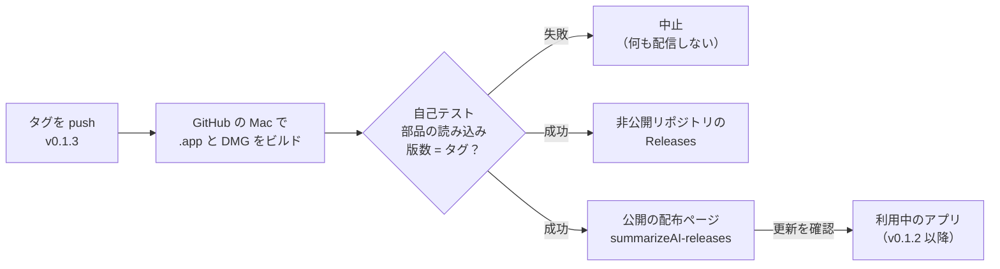
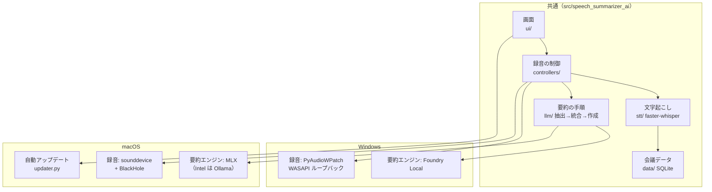

# Speech Summarizer AI

Speech Summarizer AI は、「録音 + リアルタイム文字起こし + AI 要約」を提供するデスクトップアプリです。**Windows** と **macOS（Apple Silicon の MacBook Pro など）** で動作します。

マイクで拾ったあなたの声と、オンライン会議・通話・動画などの再生音声を同時に収録し、録音中はその場で文字起こしを表示、録音停止後は内蔵 AI が自動で「会話タイトル」と「要約」を生成します。

クラウド送信は行わず、音声認識も要約 LLM も、すべて端末ローカルで動作します。
会議の音声・文字起こし・要約はあなたの PC の中だけに保存されるため、機密情報を扱う商談・1on1・社内ミーティング・インタビュー・個人のメモ取りまで、安心してお使いいただけます。

- **Windows:** Microsoft の Foundry Local をオンデバイス AI 推論基盤として採用しています。起動時に PC のハードウェア構成を検出し、利用可能なアクセラレータ（NPU、GPU、CPU）から最適な実行プロバイダーを自動的に選択します。
- **macOS:** Apple の MLX で、Apple Silicon の GPU（Metal）を使って要約 LLM を実行します。
- **文字起こし:** 日本語専用に学習された [kotoba-whisper v2.0](https://huggingface.co/kotoba-tech/kotoba-whisper-v2.0) を既定で使います（[精度](#文字起こしの精度)）。
- **自動アップデート:** 新しいバージョンが出るとアプリが知らせ、ワンクリックで更新できます（Mac）。

さらに、HP 製 PC の Programmable Key にも対応しています。
どのアプリを前面に開いていても、キーを 1 回押すだけで録音開始（リアルタイム文字起こしも同時に開始）、もう一度押せば録音停止と同時に AI 要約が自動的に始まります。Teams や Zoom、ブラウザの会議画面を最前面に保ったまま、物理キーひとつで「録る → 書き起こす → まとめる」が完結します（Mac ではキーボードショートカットで同じことができます。[後述](#録音をキーボードショートカットで操作する)）。


## 仕組み（全体像）



- **すべてこの PC の中で処理します。** 音声・文字起こし・要約が外部に送られることはありません（インターネットを使うのは、初回の AI モデル取得と更新の確認だけです）。
- 文字起こしは **録音中に 1 発話ずつ** 進み、詳細画面の「文字起こし全文」にその場で表示されます。
- 要約は **録音を止めた後** に、文字起こし全文から作られます。

### 録音から要約まで



### 会議の状態

一覧のカードに出るバッジは次の状態を表します。



「要約済み」は通常の状態なのでバッジは出しません。「要約できませんでした」になっても文字起こしは保存されているので、「再要約」でやり直せます。

---

## Mac で使う（DMG からインストール）

Apple Silicon（M1 以降）の Mac 向けです。Intel Mac は [Intel Mac の場合](#intel-mac-の場合) を参照してください。

### 1. DMG をダウンロード

**[最新版をダウンロード](https://github.com/bright-broom/summarizeAI-releases/releases/latest)**（配布用の公開ページ。ログイン不要）から `SpeechSummarizerAI-<バージョン>-arm64.dmg` を取得します。

- 公開ページに目的の版が無い場合は、[このリポジトリの Releases](https://github.com/bright-broom/summarizeAI/releases/latest) から取得できます（非公開のため閲覧権限のある GitHub アカウントでのログインが必要）。
- 過去の版は [Releases 一覧](https://github.com/bright-broom/summarizeAI-releases/releases) にあります。
- 一度インストールすれば、以降の版は[アプリ内で自動更新](#アップデート)されます（v0.1.2 以降）。
- リリース前の開発版を試す場合は、「Actions」タブ →「Build macOS DMG」→ 成功した実行 → ページ下部の **Artifacts** から取得できます（保存期間 90 日）。

### 2. インストールと初回起動



1. DMG を開き、「Speech Summarizer AI」を「Applications」フォルダへドラッグします。
2. アプリケーションフォルダ（または Launchpad）から「Speech Summarizer AI」をダブルクリックします。
   初回に「開けません」「マルウェアが含まれていないことを検証できません」と出た場合は、下の「初回起動がブロックされたとき」を参照してください。
3. マイクへのアクセスを求められたら **「許可」** します。
   拒否してしまった場合は「システム設定 → プライバシーとセキュリティ → マイク」で「Speech Summarizer AI」を ON にしてください。
4. 初回起動時に AI モデルを自動でダウンロードします（合計約 6.5GB。2 回目以降はすぐ起動します）。
   - 文字起こし: 日本語・高精度（kotoba-whisper v2.0、約 1.5GB）・標準（small）・高速（base）
   - 要約: `mlx-community/Qwen2.5-7B-Instruct-4bit`（約 4.3GB）

### アップデート

v0.1.2 以降は、新しいバージョンが公開されるとアプリの起動時（とその後 6 時間ごと）に「新しいバージョンがあります」と表示されます。

- **今すぐ更新:** ダウンロード → アプリの入れ替え → 再起動まで自動で行います。録音・要約の処理中は、終わってから更新します。
- **後で / この版をスキップ:** 次回の確認まで、またはその版については表示しません。
- 手動で確認する場合はメニューバーの「ヘルプ」→「アップデートを確認…」。
- ダウンロードしたファイルは GitHub が公開しているサイズと SHA-256 で照合し、一致しない場合は入れ替えません。入れ替えに失敗した場合は元の版に戻します。
- v0.1.1 以前にはこの機能が無いため、v0.1.2 だけは DMG から手動で入れてください。


※ 更新後、macOS がマイクへのアクセスをもう一度確認することがあります（Apple の公証を受けていないため）。その場合は「許可」してください。

### 初回起動がブロックされたとき

現在配布している DMG は Apple の公証（notarization）を受けていないため、ダウンロードしたアプリを初めて開くと macOS がブロックします。アプリが悪いのではなく「Apple が確認していない」という意味です。
**ダイアログでは「ゴミ箱に入れる」ではなく「完了」を押してから**、次のどちらかで許可してください（最初の 1 回だけ）。

- **方法A（設定画面）:** 「システム設定」→「プライバシーとセキュリティ」→ 下の方にある「"Speech Summarizer AI" は…ブロックされました」の **「このまま開く」** → もう一度アプリを開いて「このまま開く」→ パスワード入力
- **方法B（ターミナルで 1 行）:**

```bash
xattr -dr com.apple.quarantine "/Applications/Speech Summarizer AI.app"
```

macOS 15 以降では、以前の「右クリック →開く」では許可できなくなっています。
ゴミ箱に入ってしまった場合は、ゴミ箱から「Applications」へ戻すか、DMG からもう一度ドラッグしてください。

この操作を不要にするには、Apple Developer Program（年 99 USD）の「Developer ID」で署名・公証する必要があります。手順は「[署名と公証](#署名と公証警告を出さずに配布する)」を参照。

### 文字起こしの精度

一覧画面右上の「文字起こし精度」で選べます。macOS の日本語読み上げ（Kyoko）に背景雑音を混ぜた会議風の音声（約 1 分）を、アプリと同じ経路で文字起こしした結果です（GitHub の Mac・5 コアで計測、`scripts/stt_benchmark.py`）。

| 選択肢 | モデル | 文字誤り率（v0.1.1 → v0.1.2） | 処理時間 / 音声の長さ |
| --- | --- | --- | --- |
| 日本語・高精度（推奨・既定） | kotoba-whisper v2.0 | 5.7% → **2.0%** | 約 0.9 倍 |
| 標準 | Whisper small | 9.4% → **3.3%** | 約 0.3 倍 |
| 高速 | Whisper base | 16.4% → **9.0%** | 約 0.1 倍 |

v0.1.2 では、モデルの変更に加えて次の改善をしています。

#### 発話の区切り方

録音中の音声を 10ms ごとに「声がある／ない」で判定し、次のルールで 1 発話にまとめてから文字起こしします。文の途中で切ると前後の文脈が失われて誤認識が増えるため、短い間（息継ぎ）では区切りません。



#### その他の改善

- 発話の区切り方: 0.6 秒の間で区切り、短い発話はまとめ、息継ぎを残す（文の途中で切れにくい）
- 48kHz → 16kHz 変換時の雑音の折り返しを除去、小さい音量の自動補正
- 無音から生まれる定型の誤認識（「ご視聴ありがとうございました」等）を除去
- 「標準」では直前の発言を表記のヒントとして利用

「日本語・高精度」は処理が重めです。古い Mac で録音中の表示が遅れる場合は「標準」に切り替えてください（停止後に残りを処理するので文字は欠けません）。

### 3. （任意）オンライン会議・動画の音声も録音する

macOS には PC の再生音を直接録る仕組みが無いため、無料の仮想オーディオデバイス **BlackHole** を使います。設定しない場合はマイクの音だけを録音します。

1. `brew install blackhole-2ch` でインストール（必要なら Mac を再起動）
2. 「Audio MIDI 設定」アプリ → 左下の「＋」→「複数出力装置を作成」→ **スピーカー（またはヘッドホン）** と **BlackHole 2ch** にチェック
3. 「システム設定 → サウンド → 出力」で、作成した複数出力装置を選択

アプリは名前に `BlackHole` を含む入力デバイスを自動で PC 音として使います。



### 保存場所

| 内容 | 場所 |
| --- | --- |
| 会議データ・文字起こし・要約・AI モデル | `~/Library/Application Support/WEEL/SpeechSummarizerAI/` |
| 動作ログ（不具合調査用） | `~/Library/Logs/SpeechSummarizerAI.log` |

アンインストールはアプリをゴミ箱へ入れ、必要なら上記のフォルダも削除します。

### 使い方

- **録音:** 画面右下の小さなパネルの ● で開始／■ で停止。録音中は入力レベルのメーターが動きます。
  8 秒以上音が入らないと「音声なし」と表示されるので、マイクの接続と許可を確認してください。
- **文字起こし精度:** 一覧画面右上で選べます。既定の「日本語・高精度（推奨）」は日本語専用に学習された
  [kotoba-whisper v2.0](https://huggingface.co/kotoba-tech/kotoba-whisper-v2.0) を使います。
  古い Mac で文字起こしが追いつかない場合は「標準」に切り替えてください。
- **要約:** 停止するとパネルに「要約中…」と出て、終わると一覧に要約が表示されます。
- **一覧:** カードをクリックすると要約と文字起こしを開きます。要約に失敗した録音は「再要約」でやり直せます。
- **詳細:** 「コピー」で要約をクリップボードへ（メールやドキュメントには見出し・箇条書きのまま貼れます）。
  文字起こしタブの「コピー」は時刻付きの全文をコピーします。鉛筆アイコンで要約を編集できます。
- Mac ではアプリを開いただけでは録音を始めません（Windows は従来どおり起動と同時に録音開始）。
- パネルの × はアプリの終了です。録音中・要約中は確認が出ます。

### 録音をキーボードショートカットで操作する

「ショートカット」アプリで新規ショートカットに「シェルスクリプトを実行」を追加し、次を入力してキーボードショートカットを割り当てます。

```bash
open -n -a "Speech Summarizer AI" --args --record
```

アプリが起動していなければ起動して録音を開始し、起動中なら録音の開始／停止を切り替えます（HP Programmable Key と同じ動き）。

### メモリが少ない Mac の場合

要約モデルは 16GB 以上のメモリを想定しています。8〜16GB の Mac では、ターミナルで次を実行してから起動すると小さいモデルを使います。

```bash
launchctl setenv SSAI_MLX_MODEL mlx-community/Qwen2.5-3B-Instruct-4bit
```

### Intel Mac の場合

配布している DMG は Apple Silicon 専用です。Intel Mac では [Mac で自分でビルドする](#mac-で自分でビルドする) 手順で作成してください。要約には MLX の代わりに Ollama を使うため、事前に次を実行しておきます。

```bash
brew install ollama
```

```bash
ollama pull qwen2.5:7b
```

（Ollama アプリを起動しておくか、`ollama serve` を実行しておきます）

---

## Mac で自分でビルドする

Python 3.11 以上と Xcode コマンドラインツールが必要です。

```bash
brew install python@3.12
```

```bash
xcode-select --install
```

リポジトリのルートで次を 1 回実行します（初回は 5〜10 分程度）。

```bash
./scripts/build_mac_app.sh
```

次の 2 つが作られます。

- `/Applications/Speech Summarizer AI.app` — そのままダブルクリックで起動できます
- `dist/SpeechSummarizerAI-<バージョン>-<arm64|x86_64>.dmg` — 他の Mac に配る用

オプション: `--no-install`（/Applications へコピーしない）、`--no-dmg`（DMG を作らない）。

### GitHub Actions で DMG を作る

`.github/workflows/build-macos-dmg.yml` が、GitHub の Mac（Apple Silicon）上で `.app` と DMG を作成します。

- **手動実行:** 「Actions」タブ →「Build macOS DMG」→「Run workflow」。`release_tag` に既存のタグ（例 `v0.1.2`）を入れると、その版の DMG を作り直して Releases に載せ直します（公開リポジトリへの配信のやり直しにも使えます）
- **リリース:** 下の「[新しいバージョンを配信する手順](#新しいバージョンを配信する手順)」を参照

ビルド後に、作成した `.app` に同梱ライブラリ（MLX・sounddevice・faster-whisper・PySide6 など）が読み込めるかを確認するセルフテスト（`SSAI_SELFTEST=1`）を実行します。失敗した場合はジョブが失敗し、DMG はアップロード・リリースされません。

### 署名と公証（警告を出さずに配布する）

Apple Developer Program に加入していれば、GitHub Actions で Developer ID 署名と Apple の公証を自動で行い、ダウンロードした人の Mac で警告が出ない DMG を作れます。

1. Apple Developer で **Developer ID Application** 証明書を作成し、キーチェーンアクセスから `.p12` で書き出す
2. [appleid.apple.com](https://appleid.apple.com) で **App 用パスワード** を発行する
3. GitHub のリポジトリ → Settings → Secrets and variables → Actions に次を登録する

| Secret | 内容 |
| --- | --- |
| `MACOS_CERT_P12_BASE64` | `base64 -i cert.p12 \| pbcopy` でコピーした値 |
| `MACOS_CERT_PASSWORD` | `.p12` 書き出し時のパスワード |
| `MACOS_SIGN_IDENTITY` | `Developer ID Application: 氏名 (TEAMID)` |
| `APPLE_ID` | Apple ID のメールアドレス |
| `APPLE_TEAM_ID` | 10 桁のチーム ID |
| `APPLE_APP_PASSWORD` | 手順 2 の App 用パスワード |

登録後にタグを push するか「Run workflow」を実行すると、署名・公証済みの DMG が作られます（未登録の場合は従来どおりのアドホック署名）。
自分の Mac でビルドする場合は、同じ名前の環境変数を設定して `./scripts/build_mac_app.sh` を実行します。

### 自動アップデートの配信（初回のみの準備）

ソースコードのリポジトリは非公開のまま、DMG だけを公開リポジトリ `bright-broom/summarizeAI-releases` に載せて配信します。

1. GitHub で **公開（Public）** リポジトリ `summarizeAI-releases` を作成する（「Add a README file」にチェック）
2. [Fine-grained personal access token](https://github.com/settings/personal-access-tokens/new) を作成する
   - Repository access: **Only select repositories** → `summarizeAI-releases` だけ
   - Permissions: **Contents → Read and write**
3. **このリポジトリ（summarizeAI）** の Settings → Secrets and variables → **Actions** →「**Secrets**」タブ →「**New repository secret**」で、名前 `RELEASES_REPO_TOKEN` として登録する

登録を間違えやすい点（ビルドから見えないと公開リポジトリへの配信が「skipped」になります）:

- 「Variables」タブではなく「**Secrets**」タブに登録する
- 「Environment secrets」ではなく「**Repository secrets**」に登録する
- 「Codespaces」「Dependabot」ではなく「**Actions**」に登録する
- 登録先は配布用の `summarizeAI-releases` ではなく、ビルドが動く **`summarizeAI`**

既に出した版を公開リポジトリへ配信し直すには、「Actions」→「Build macOS DMG」→「Run workflow」で `Use workflow from` にそのタグ（例 `v0.1.2`）を選び、`release_tag` に同じタグを入れて実行します。

### 新しいバージョンを配信する手順

1. 次の 3 か所の版数を上げて `main` に反映する
   - `pyproject.toml` の `version`
   - `src/speech_summarizer_ai/__init__.py` の予備の版数
   - `speech_summarizer_ai_mac.spec` の `APP_VERSION`
2. 同じ版数のタグを push する（例: 版数が `0.1.3` なら `v0.1.3`）

```bash
git pull && git tag v0.1.3 && git push origin v0.1.3
```

ビルド・自己テスト後、このリポジトリと `summarizeAI-releases` の両方の Releases に DMG が載り、利用中のアプリに更新の案内が出ます。


タグと `pyproject.toml` の版数が一致しない場合はビルドが失敗します（誤った版数の配信を防ぐため）。

### 文字起こし精度のベンチマーク

`.github/workflows/stt-benchmark.yml` が、GitHub の Mac で日本語の読み上げ音声を各モデルで文字起こしし、文字誤り率と処理時間を表にします。

- 文字起こし関連のファイル（`src/speech_summarizer_ai/stt/`・`settings/stt.py`・`scripts/stt_benchmark.py`）を変更した PR では自動で実行されます
- 手動実行: 「Actions」→「STT benchmark」→「Run workflow」
- 結果は実行結果ページの Summary に出ます。改善を 1 つずつ有効にした場合の比較と、実際に配布する設定（「採用設定」）の行があります

変更の効果は、この表で「採用設定」の文字誤り率が下がることを確認してから取り込んでください。

### .app を作らずに開発用に起動する

```bash
./scripts/setup_mac.sh
```

```bash
./scripts/run_mac.command
```

この方法ではマイク許可が「ターミナル」に対して求められます。

### macOS 版の仕組み

Windows 版と macOS 版は画面・文字起こし・データ保存を共有し、OS ごとに違う部分だけを差し替えています。



Windows 専用の部品を次のように置き換えています。

| 機能 | Windows | macOS |
| --- | --- | --- |
| マイク録音 | PyAudioWPatch (WASAPI) | sounddevice (CoreAudio)。`audio/mac_pyaudio_compat.py` |
| PC 再生音の録音 | WASAPI ループバック | BlackHole 等の仮想オーディオデバイス（任意） |
| 要約 LLM | Foundry Local (WinML) | MLX（Apple Silicon）/ Ollama 等の OpenAI 互換サーバー（Intel）。`llm/mac_backend.py` |
| データ保存先 | `%LOCALAPPDATA%\WEEL\SpeechSummarizerAI` | `~/Library/Application Support/WEEL/SpeechSummarizerAI` |
| 実行ファイル | `speech_summarizer_ai.spec`（EXE） | `speech_summarizer_ai_mac.spec`（.app / DMG） |
| 自動アップデート | なし | `updater.py` / `ui/update_prompt.py`（公開リポジトリの Releases から取得） |

### 環境変数（任意）

`.app` に渡す場合は `launchctl setenv 変数名 値` を実行してからアプリを起動します（Mac を再起動すると解除されます）。

| 変数 | 内容 |
| --- | --- |
| `SSAI_MLX_MODEL` | MLX モデルの Hugging Face リポジトリ（既定 `mlx-community/Qwen2.5-7B-Instruct-4bit`） |
| `SSAI_LLM_BACKEND` | `mlx` / `openai`。Intel Mac は自動で `openai` |
| `SSAI_OPENAI_BASE_URL` / `SSAI_OPENAI_MODEL` | OpenAI 互換サーバー（既定 `http://localhost:11434/v1` / `qwen2.5:7b`） |
| `SSAI_LOOPBACK_DEVICE` | PC 音として使う入力デバイス名（部分一致。既定は `BlackHole` 等を自動検出） |
| `SSAI_DATA_DIR` | DB・モデル・セッションの保存先 |

---

## Windows で使う

### セットアップと起動

仮想環境を作成して依存関係を入れます。

```bash
python -m venv venv
venv\Scripts\activate
pip install -r requirements.txt
```

または、パッケージを editable install すると `speech-summarizer-ai` コマンドが使えます。

```bash
pip install -e .
```

開発時はリポジトリルートから次のいずれかで起動できます。

```bash
python scripts/run_dev.py
```

editable install 後は次のコマンドでも起動できます。

```bash
speech-summarizer-ai
python -m speech_summarizer_ai
```

録音は `sessions/<セッションID>/audio.wav` に保存されます（基準ディレクトリは後述の `project_root()`。Windows の配布版では **ユーザーデータ領域** 側の `sessions/` です）。

### Windows 実行ファイルの作成（PyInstaller）

前提:

- Windows PC、**このリポジトリ用**の仮想環境で `requirements.txt`（または `pip install -e .`）を満たしていること（別プロジェクトの venv だと `webrtcvad` 不足などで PyInstaller の hook が失敗することがあります）
- リポジトリルートで作業する

手順:

```bash
venv\Scripts\activate
pyinstaller --noconfirm speech_summarizer_ai.spec
```

クリーンビルドする場合:

```bash
pyinstaller --noconfirm --clean speech_summarizer_ai.spec
```

成果物は **`dist/SpeechSummarizerAI/`** フォルダ（onedir）です。`SpeechSummarizerAI.exe` と同フォルダの DLL 群を一式配布してください。

---

## リポジトリ構成

- `src/speech_summarizer_ai/` — アプリ本体（`settings` / `platform_utils` / `domain` / `data` / `audio` / `stt` / `llm` / `controllers` / `ui`）。
- `resources/icons/` — アイコン（`app.svg`、Windows 用 `app.ico`、macOS 用 `app.icns`）。PyInstaller で EXE / .app に同梱される。
- `src/speech_summarizer_ai/stt/` — 文字起こし（`realtime.py` が発話の区切りと認識、`faster_whisper_engine.py` がモデル呼び出し、`model_downloader.py` がモデル取得）。
- `src/speech_summarizer_ai/updater.py` と `ui/update_prompt.py` — 自動アップデート。
- `scripts/` — 開発用起動 `run_dev.py`、macOS 用 `setup_mac.sh` / `run_mac.command` / `build_mac_app.sh`、文字起こしベンチマーク `stt_benchmark.py`。
- `packaging/` — PyInstaller 用 `hook-webrtcvad`、macOS の署名用 `macos/entitlements.plist`。
- `.github/workflows/build-macos-dmg.yml` — macOS 用 DMG のビルド・リリース・公開リポジトリへの配信。
- `.github/workflows/stt-benchmark.yml` — 文字起こし精度のベンチマーク。
- `pyproject.toml` — パッケージ定義。`requirements.txt`（Windows）/ `requirements-mac.txt`（macOS）— 依存関係。
- `speech_summarizer_ai.spec` — Windows 向け PyInstaller 定義。`speech_summarizer_ai_mac.spec` — macOS 向け（.app）。
- `tests/` — テスト（`pytest`）。macOS 用の録音・要約レイヤ、文字起こしの前処理と区切り方、自動アップデートは Windows / Linux 上でも検証できる。
- 実行時データ（SQLite・録音・ローカルモデル）は `platform_utils.paths.project_root()` を基準に `database/`・`sessions/`・`models/` を置く。
  - **Windows:** WinRT の `ApplicationData` が使える環境（MSIX 等）ではそのローカルフォルダ。**未パッケージの EXE** などでは `%LOCALAPPDATA%\WEEL\SpeechSummarizerAI\`。
  - **macOS:** `~/Library/Application Support/WEEL/SpeechSummarizerAI/`（`SSAI_DATA_DIR` で変更可）。
  - **その他の OS:** リポジトリルート（`src` の親）。
